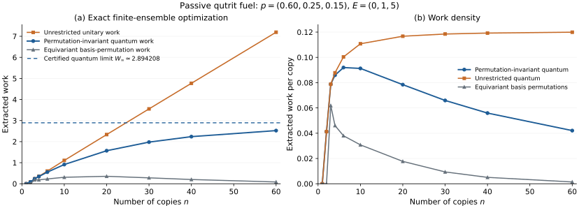

# Collective Fluctuation Work

**How much work can a large passive ensemble provide when every control treats its copies identically?** For a fixed strictly passive, full-rank source, the maximum work under all permutation-invariant unitaries stays bounded as the ensemble grows. It converges to an explicit fluctuation-state ergotropy, which is positive precisely when the source is non-Gibbs.

The control set includes arbitrary entangling unitaries that commute with every permutation. The result therefore concerns the symmetry of control access, even when arbitrary interaction strength, duration and order are allowed within that symmetry.

| Controls on a fixed non-Gibbs passive source | Asymptotic total work |
|---|---|
| Independent single-copy unitaries | Zero |
| All permutation-invariant unitaries | A positive finite limit |
| Unrestricted joint unitaries | Proportional to the number of copies |

The unrestricted activation benchmark is [established prior work](references/RELATED_WORK.md#unrestricted-work-activation). The finite collective-work law is the contribution developed here.

## Principal result

Let $`H=\mathrm{diag}(E_1,\ldots,E_d)`$ with $`E_1<\cdots<E_d`$, and let $`\rho=\mathrm{diag}(p_1,\ldots,p_d)`$ with $`p_1>\cdots>p_d>0`$. The dimension, Hamiltonian and state remain fixed as $`n`$ grows. Define

```math
W_n^{\mathrm{sym}}
=\max_{[U,P_\pi]=0\ \forall\pi\in S_n}
\mathrm{Tr}\!\left[H_n\left(\rho^{\otimes n}-U\rho^{\otimes n}U^\dagger\right)\right],
\qquad H_n=\sum_{a=1}^n H^{(a)}.
```

The [main theorem](science/model_and_main_theorem.md) proves a uniform bound $`W_n^{\mathrm{sym}}\le C(\rho,H)`$ and the exact limit

```math
\lim_{n\to\infty} W_n^{\mathrm{sym}}
=\mathcal W\!\left(\tau_\infty,K_\infty\right)<\infty.
```

There is one mathematical oscillator mode for each pair of energy levels. Its energy gap is $`E_j-E_i`$ and its geometric occupation ratio is $`p_j/p_i`$. The known oscillator description becomes an exact work law through the [spectral construction](science/schur_tableau_spectrum.md), [passive-rearrangement argument](science/passive_rearrangement.md), and [energy-controlled limit](science/fluctuation_limit.md). These modes describe fluctuations within symmetry sectors; no auxiliary physical oscillators are supplied to the protocol.

For an arbitrary known source with a strictly ordered, full-rank spectrum, the collective activation premium above independent work extraction is finite:

```math
W_n^{\mathrm{sym}}(\rho,H)
=n\mathcal W(\rho,H)+W_n^{\mathrm{sym}}(\rho_{\mathrm{pass}},H).
```

For a fixed partition into $`b`$ control classes, all global unitaries respecting the independent within-class permutations obey $`W_{n,b}\le bC(\rho,H)`$. This remains true when the controls entangle different classes. Consequently, a sublinear number of static control classes cannot unlock extensive work from passive fuel. See [control consequences](science/consequences.md).

## A fully specified qutrit example

For $`p=(0.60,0.25,0.15)`$ and $`E=(0,1,5)`$, exact integer calculations give the following values, rounded for display:

| Copies | Collective quantum work | Unrestricted work | Equivariant basis-permutation work |
|---:|---:|---:|---:|
| 2 | 0.082500 | 0.082500 | 0 |
| 20 | 1.568210 | 2.334684 | 0.354201 |
| 60 | 2.523924 | 7.195052 | 0.085145 |

The limiting quantum work has the certified enclosure

```math
2.894208160219019\ \le W_\infty\le\ 2.894208160219020.
```

An explicit swap of two fluctuation modes extracts $`33/14`$ in the limit. Equivariant basis permutations form a restricted reversible classical benchmark. Its work vanishes exponentially under the same strict population ordering. The [classical comparison](science/classical_comparison.md) credits the prior stabilizer obstruction and proves this consequence, with the operation class kept distinct from stochastic or bath-assisted classical thermodynamics.



Markers are exact finite-size optimizations; connecting lines guide the eye. The horizontal line is the independently certified oscillator-work limit. The [qutrit account](science/qutrit_example.md) gives the construction, exact arithmetic and energy-tail error bound.

## Read and reproduce

Start with the [science overview](science/README.md), then follow the theorem and proof pages above. [Related work](references/RELATED_WORK.md) distinguishes inherited representation-theoretic ingredients from the optimized work law. The [source locator table](science/theorem_source_locators.md) identifies the exact primary statements used by the proof. [The reading guide](llms.txt) maps questions to their authoritative pages.

For a guided route, start with the [learning overview](learning/README.md), then use the [Watrous source bridge](learning/anchor_bridge.md) and [30-milestone map](learning/milestones.md). The anchor is John Watrous, *The Theory of Quantum Information* (Cambridge, 2018): majorization and permutation-invariant operator algebras provide the foundations; the bridge supplies the thermodynamic interpretation and points to the additional representation-theoretic proof ingredients.

From the repository root:

```bash
python3 -m pip install -r verification/requirements.txt
python3 verification/run_all.py
```

The [verification account](verification/README.md) explains the exact finite-size computations, directed numerical interval, independent low-dimensional projector checks, and their limits. The general theorem is established analytically; finite calculations do not replace its proof.

## Operational scope

Work means the mean energy decrease in a closed cyclic unitary process on one fixed ensemble. The theorem uses exact commutation of each allowed unitary with every permutation. Covariance of an averaged noisy channel is a weaker condition. Baths, discarded ancillary entropy sinks, reset measurement records, or changing the control partition alter the task. Fixed strict population gaps are essential to the stated finite limit. Efficient compilation and finite-time tolerance to symmetry breaking are separate implementation questions.

## Purpose and contact

This repository serves as a record of the work and a guide for the author’s self-directed learning. For discussion or potential collaboration, please contact Ruge Lin at [gogoko699@gmail.com](mailto:gogoko699@gmail.com).
