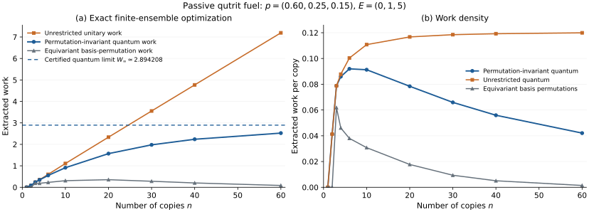

# A passive qutrit with finite collective work

Consider the fixed source and Hamiltonian

```math
\rho=\operatorname{diag}\!\left(\frac35,\frac14,\frac3{20}\right),
\qquad H=\operatorname{diag}(0,1,5).
```

The probabilities decrease strictly with energy, so one copy is passive. Their logarithmic ratios are not proportional to the energy gaps, so the state is non-Gibbs. Work is measured in units of the first excitation gap. The initial mean energy of each copy is one.

## Two copies already allow extraction

Label the single-qutrit basis states by $`0,1,2`$. Swap the two vectors

```math
|11\rangle
\quad\longleftrightarrow\quad
\frac{|02\rangle+|20\rangle}{\sqrt2},
```

and act as the identity on their orthogonal complement. Both vectors are symmetric under exchange of the copies. Their energies are $`2`$ and $`5`$, and their populations are $`1/16`$ and $`9/100`$. This permutation-invariant unitary extracts

```math
W_2^{\mathrm{sym}}
=(5-2)\left(\frac9{100}-\frac1{16}\right)
=\frac{33}{400}=0.0825.
```

Exact sector sorting shows that this is the two-copy optimum. Equivariant bijections of the product basis extract zero at this copy number. Such bijections cannot replace a pair of distinct-symbol strings by a coherent symmetric vector; their [stabilizer restriction](classical_comparison.md) is different. Their optimum can be positive at other finite copy numbers.

## The limiting state

The [main theorem](model_and_main_theorem.md) gives three fluctuation modes:

| Mode | Geometric ratio | Energy gap | Mean occupation |
|---|---:|---:|---:|
| $`12`$ | $`5/12`$ | $`1`$ | $`5/7`$ |
| $`13`$ | $`1/4`$ | $`5`$ | $`1/3`$ |
| $`23`$ | $`3/5`$ | $`4`$ | $`3/2`$ |

For occupations $`(a,b,c)`$, the probability and excitation energy are

```math
q(a,b,c)=\frac7{40}\left(\frac5{12}\right)^a
                     \left(\frac14\right)^b
                     \left(\frac35\right)^c,
\qquad K(a,b,c)=a+5b+4c.
```

The mean excitation energy is $`176/21`$. These modes describe the joint spectrum within deep Schur sectors; the extraction task supplies no physical oscillator ancillas.

Swapping the complete $`12`$ and $`23`$ modes extracts

```math
W_{\mathrm{swap}}
=(4-1)\left(\frac32-\frac57\right)
=\frac{33}{14}=2.357142857\ldots.
```

This is about $`81.44\%`$ of the optimum. Finite versions restrict the swap to an occupation set invariant under exchange of the two coordinates and act as the identity outside it. Every fixed finite version embeds into sufficiently deep sectors, as proved in [the control consequences](consequences.md). This establishes asymptotic attainability without asserting an efficient circuit or laboratory implementation.

## A rigorous numerical enclosure

Let $`W_R`$ be the work extracted by sorting the original, unnormalized probabilities on the complete energy subspace $`K\le R`$, leaving its complement fixed. The [passive-rearrangement proof](passive_rearrangement.md) gives

```math
0\le W_\infty-W_R
\le T_R,
\qquad T_R=\operatorname{Tr}\!\left[\tau_\infty K\mathbf1_{K>R}\right].
```

The complete energy subspace matters: the retained energy list consists of the first entries of the full ordered energy spectrum. A small omitted probability in an arbitrary occupation box does not establish this work-error bound.

Here the change of variables $`u=a+b`$, $`v=b+c`$ groups equal joint eigenvalues:

```math
q(u,v)=\frac7{40}\left(\frac5{12}\right)^u
                    \left(\frac35\right)^v,
\qquad K(u,v)=u+4v,
\qquad m(u,v)=\min(u,v)+1.
```

At $`R=320`$, there are $`13{,}041`$ such labels representing $`287{,}361`$ basis states. All probabilities share an exact integer denominator, so the calculation sorts integer numerators with their multiplicities. The omitted first moment is less than $`6.786\times10^{-16}`$. Directed rounding of the exact rational endpoints yields

```math
\boxed{
2.894208160219019088
\le W_\infty\le
2.894208160219019768.
}
```

The [verification account](../verification/README.md) derives the common denominator, explains the independent projector checks and gives the reproduction commands. [The saved results](../verification/results/certified_results.json) contain the exact fractions and directed endpoints.

## Finite ensembles and the control comparison



Markers show exact finite-copy optimizations. Straight segments guide the eye between the enumerated copy numbers; no convergence rate is fitted. The dashed horizontal line shows the certified limiting collective work.

| Copies | Permutation-invariant quantum work | Equivariant basis-permutation work | Unrestricted work |
|---:|---:|---:|---:|
| 2 | 0.082500000000 | 0 | 0.082500000000 |
| 10 | 0.912633119243 | 0.307554543422 | 1.107609927950 |
| 20 | 1.568210375767 | 0.354201258961 | 2.334683845207 |
| 40 | 2.236961562299 | 0.202076432155 | 4.769170652028 |
| 60 | 2.523923873461 | 0.085145102519 | 7.195051588108 |

Values are rounded displays of exact rational calculations. At $`n=60`$, collective work is still approximately $`0.370284`$ below its limit. The finite table supports the example; the analytical theorem establishes convergence. The classical comparison concerns reversible equivariant basis permutations, and its exponential upper bound need not be tight at these sizes. Unrestricted joint unitaries permit the established extensive activation of a passive non-Gibbs source.
